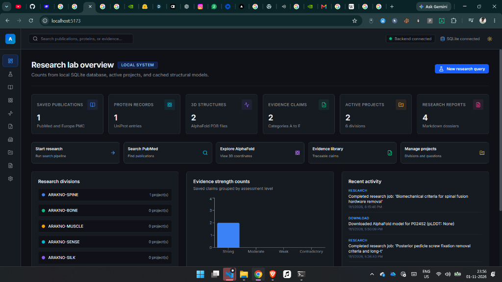
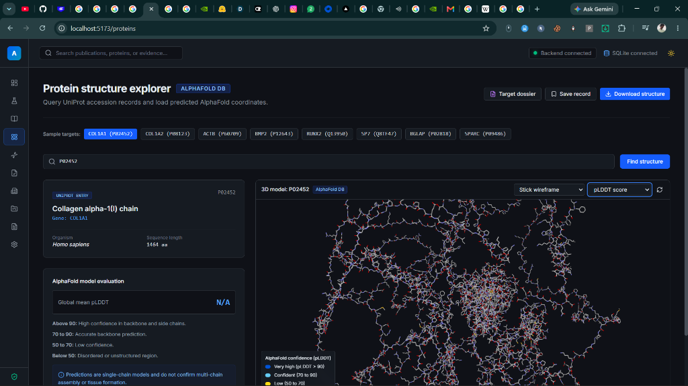
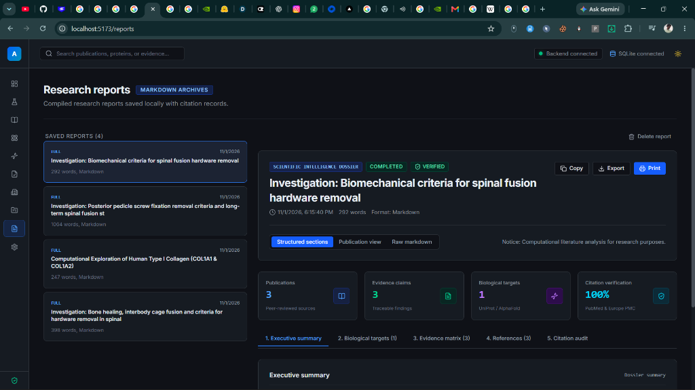

# ARAKNO-AI

**An Open-Source AI-Powered Biomedical Research Intelligence Initiative**  
*Advanced Research and Knowledge Architecture for Novel Organism-inspired Biomedical Research*


---

## Project Overview

ARAKNO-AI is an open-source initiative dedicated to exploring the intersection of Artificial Intelligence, Computational Biology, Biomedical Engineering and Bioinspired Science.

Our primary aim is to develop an intelligent research ecosystem that accelerates scientific discovery through automated literature analysis, protein structure exploration, biological data analysis, evidence synthesis and interdisciplinary collaboration.

---

## Main Research Mission

To investigate human biological systems and explore scientifically supported possibilities for tissue regeneration, advanced biomaterials, bone healing, spinal reconstruction and long-term implant independence.

---

## Research Divisions

- **ARAKNO-SPINE:** Spinal biomechanics, spinal fusion, implant integration and implant-removal research.
- **ARAKNO-BONE:** Bone biology, collagen, mineralization and regeneration.
- **ARAKNO-MUSCLE:** Muscle biology, biomechanics and tissue regeneration.
- **ARAKNO-SENSE:** Mechanoreceptors and biological sensory systems.
- **ARAKNO-SILK:** Spider silk proteins, spidroins and bioinspired biomaterials.
- **ARAKNO-NEURO:** Neural systems, sensory-motor coordination and nerve regeneration.

---

## User Interface & Screenshots

### 1. Research Lab Overview
Real-time dashboard summarizing active biomedical projects, evidence strength distributions, saved literature, 3D structures, and system diagnostics.



### 2. Protein Structure Explorer & AlphaFold 3D Viewer
Interactive 3D molecular viewer with residue wireframes, pLDDT prediction confidence metrics, and UniProt biological annotation records.



### 3. Scientific Intelligence Dossier & Research Reports
Structured multi-section research dossiers with verified PubMed/Europe PMC citation audits, biological targets, and evidence synthesis matrices.



---

## Technology and Research

ARAKNO-AI combines Agentic AI, LangGraph, Python, React, FastAPI, computational biology and publicly accessible scientific resources, including PubMed, Europe PMC, UniProt and AlphaFold Protein Structure Database.

### Technology Stack
| Layer | Technologies |
|-------|-------------|
| Frontend | React, TypeScript, Tailwind CSS, Vite, Recharts, 3Dmol.js |
| Backend | Python, FastAPI, SQLAlchemy, Pydantic |
| Database | SQLite with FTS5 |
| AI / Agents | LangGraph, LangChain (optional LLM support) |
| Biology | Biopython, UniProt API, AlphaFold DB |
| APIs | PubMed, Europe PMC, AlphaFold DB, UniProt |

### Core Capabilities
- 📚 **Literature Intelligence** — Search PubMed and Europe PMC, save and organize publications
- 🧬 **Protein Explorer** — UniProt metadata + AlphaFold structure predictions with 3D viewer
- 🔬 **Computational Biology** — FASTA analysis, sequence alignment, structure parsing
- 📊 **Evidence Library** — Structured evidence records with quality categorization
- 🤖 **AI Research Workflows** — LangGraph-powered research automation
- 📝 **Research Reports** — Generated, traceable scientific reports
- 🔒 **Privacy-First** — Local-only, no cloud dependencies, no data exfiltration

---

## Open Collaboration

We welcome AI developers, computational biologists, biomedical researchers, bioengineers, biotechnology students and scientific enthusiasts to contribute through software development, literature reviews, protein research, scientific validation, documentation and new research ideas.

Please read our [Contributing Guide](CONTRIBUTING.md) and [Code of Conduct](CODE_OF_CONDUCT.md) to get started.

---

## Our Vision

Build an open, collaborative, evidence-driven research ecosystem that uses AI and interdisciplinary science to investigate complex biological challenges and advance future biomedical innovation.

> **Important Research Notice**: ARAKNO-AI is a research initiative, not a clinically validated medical platform. Scientific hypotheses will always be distinguished from experimentally established findings.
>
> **Research Together. Explore Biology. Build Scientific Possibilities.**

---

## Quick Start

### Prerequisites
- Python 3.11+ 
- Node.js 18+ LTS
- npm
- Windows 10/11 (or Linux / macOS)

### Installation

```powershell
cd ARAKNO-AI
.\scripts\setup.ps1
```

### Configuration

1. Copy `.env.example` to `.env` (done automatically by setup)
2. Edit `.env` to set your NCBI email (recommended for PubMed access)
3. Optionally configure an LLM provider

### Running

```powershell
# Start both services
.\scripts\run-all.ps1

# Or start individually
.\scripts\run-backend.ps1   # http://127.0.0.1:8000
.\scripts\run-frontend.ps1  # http://localhost:5173
```

### Stopping

```powershell
.\scripts\stop-all.ps1
```

---

## Architecture

```
Frontend (React)  ←→  Backend (FastAPI)  ←→  Scientific APIs
     ↓                      ↓                       ↓
  Browser              SQLite DB            PubMed, UniProt,
  UI/UX               Local Files          AlphaFold, Europe PMC
```

- Frontend and backend are independent
- All scientific integrations go through the backend
- No API keys stored in frontend
- All data persisted locally in SQLite

---

## Privacy & Security

- **Local-only**: Bound to 127.0.0.1 / localhost
- **No cloud dependencies**: Works fully offline (except API searches)
- **LLM disabled by default**: No paid API calls without explicit configuration
- **Private data isolation**: Medical records stored separately
- **No data exfiltration**: No automatic uploads to external services
- **API key protection**: Never logged, never returned in responses

---

## API Documentation

When the backend is running, visit:
- Swagger UI: http://127.0.0.1:8000/docs
- ReDoc: http://127.0.0.1:8000/redoc

---

## Project Structure

```
ARAKNO-AI/
├── frontend/          # React + TypeScript + Tailwind
├── backend/           # Python FastAPI
├── data/              # Local data storage
│   ├── database/      # SQLite database
│   ├── papers/        # Downloaded papers
│   ├── structures/    # Protein structures
│   ├── reports/       # Generated reports
│   ├── cache/         # API response cache
│   └── private_case/  # Private medical data (isolated)
├── docs/              # Documentation & Architecture
│   └── images/        # UI screenshots & visual assets
├── scripts/           # Setup and launch scripts
└── .env               # Configuration (not in git)
```

---

## Disclaimer

This software is a research tool for scientific literature exploration and computational biology research. It is **not** a medical device, diagnostic tool, or clinical decision support system.

- AI-generated analyses are computational interpretations, not clinical evidence
- Protein structure predictions are models, not experimental results
- All research findings should be verified against primary literature
- No clinical decisions should be based solely on this software's output

---

## Contributing

We welcome community contributions! Please read our [Contributing Guide](CONTRIBUTING.md) and [Code of Conduct](CODE_OF_CONDUCT.md) before submitting issues or pull requests.

## Security

Please report security vulnerabilities responsibly as described in [SECURITY.md](SECURITY.md).

## Citation

If you use ARAKNO-AI in your academic research or computational studies, please cite it using the metadata in [CITATION.cff](CITATION.cff).

## License

This project is licensed under the MIT License - see the [LICENSE](LICENSE) file for details.
